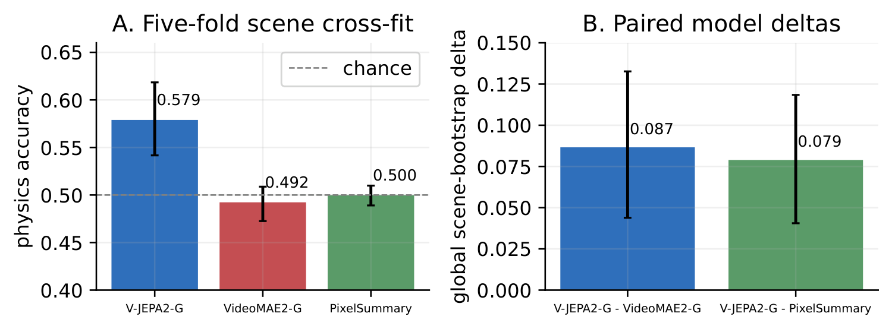
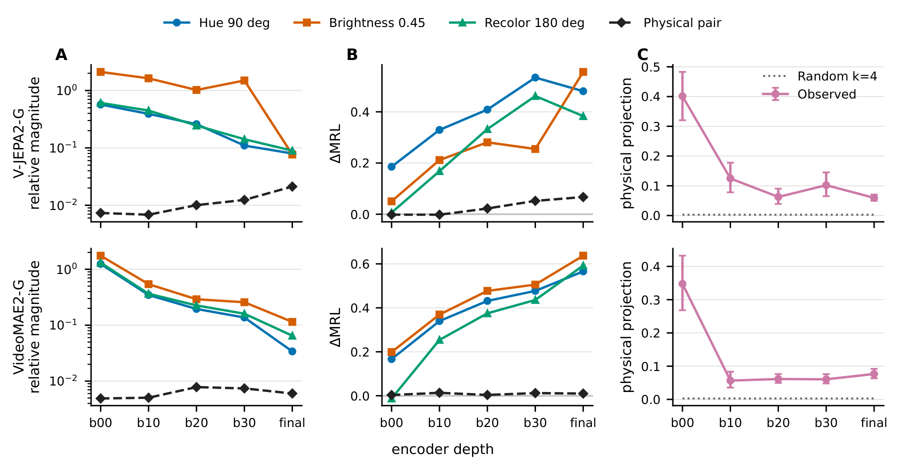
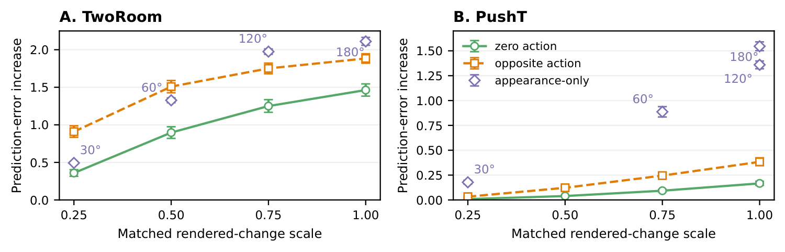
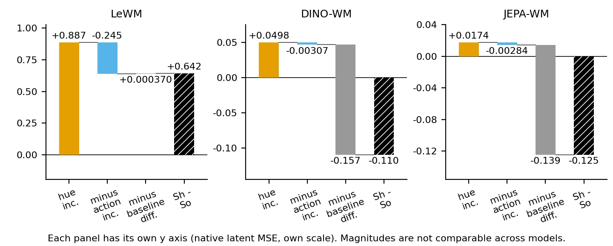
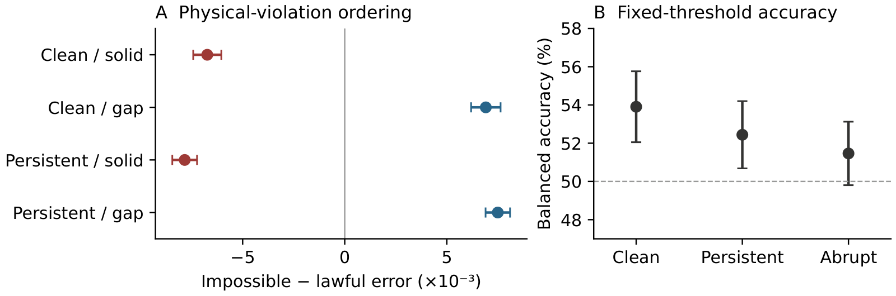

<h1 align="center"><a href="https://3-ml.github.io/jepa-surprise/">When Does Latent Prediction Error Support Physical Surprise Claims in Video World Models?</a></h1>

<p align="center"><strong>Accepted at the NeurIPS 2026 Workshop on World Models in Physical AI (WM-PAI)</strong></p>

<p align="center">
  <a href="https://toni.foo/">Anton Hristov</a><sup>1,*</sup> &nbsp;·&nbsp;
  Aleksandar Slavov<sup>2,*</sup> &nbsp;·&nbsp;
  <a href="https://vasi.boo/">Vasil Vasilev</a><sup>1,*</sup><br>
  <sup>1</sup> Technology School Electronic Systems (TUES)<br>
  <sup>2</sup> Baba Tonka High School of Mathematics<br>
  <sup>*</sup> Equal contribution
</p>

<p align="center">
  <a href="https://3-ml.github.io/jepa-surprise/"><strong>Project website</strong></a> &nbsp;·&nbsp;
  <a href="https://arxiv.org/abs/2611.01815"><strong>Paper</strong></a> &nbsp;·&nbsp;
  <a href="https://arxiv.org/pdf/2611.01815"><strong>PDF</strong></a> &nbsp;·&nbsp;
  <a href="release/README.md"><strong>Scientific release</strong></a> &nbsp;·&nbsp;
  <a href="#citation"><strong>BibTeX</strong></a>
</p>

> **A model can contain physical information and respond to incorrect actions without its native prediction error reliably measuring physical surprise.** We test these claims separately, using frozen-feature readouts, representation geometry, and controlled changes to actions, appearance, motion, and physical possibility.

**Start here:** [Research questions](#what-we-evaluate) · [Findings](#findings) · [Experiment records](#experiment-map) · [Reproduce](#reproduce-and-verify) · [Models and data](#models-data-and-hardware) · [Limitations](#interpretation-and-limitations) · [Citation](#citation)

## What we evaluate

| Question | Test | What it can establish |
|---|---|---|
| **01 · What can a classifier recover?** | Linear probes on frozen IntPhys2 features, with scenes held out from training | Accessibility of physical and appearance labels—not the meaning of native prediction error |
| **02 · How do the features change?** | Relative displacement, directional coherence, and cross-fitted subspace overlap | Geometric organization—not semantic disentanglement or a causal explanation of error |
| **03 · What changes prediction error?** | Matched action, appearance, static-content, and possible/impossible comparisons; a development-fixed cutoff | How the evaluated score behaves under specified controls—not general physical competence |

The study compares **V-JEPA2-G, V-JEPA2-L, VideoMAE2-G, LeWorldModel, DINO-WM, and JEPA-WM**, with simple visual statistics as a readout baseline. Models retain their own score definitions; raw error magnitudes are not a common scale across models.

## Findings

### 01 / Readouts — physical labels are modestly accessible

On **57 IntPhys2 scenes**, V-JEPA2-G's possible/impossible classification accuracy is **57.9%**, compared with **49.2%** for VideoMAE2-G and **50.0%** for PixelSummary. Its four-class appearance accuracy is approximately **98%**. The two classification tasks do not measure information on a common scale.

<p align="center"><a href="docs/readme-assets/readouts.webp"></a></p>

*Five-fold scene cross-fitting keeps a scene's pairs and appearance variants together. This is a post-hoc corrective analysis; intervals hold fitted predictions fixed and omit refitting/fold-assignment uncertainty. Paper Figure 4.*

### 02 / Geometry — appearance shifts change across layers

Appearance shifts become smaller **relative to distances between unrelated videos**, while their directions become more consistent across scenes. Physical changes overlap less with the final appearance subspace than with the initial one, but the trajectory is not monotonic and the final overlap remains above a dimension-matched random reference.

<p align="center"><a href="docs/readme-assets/geometry.webp"></a></p>

*Relative displacement is not absolute contraction, and reduced overlap is not complete separation. Paper Figure 2.*

A separate **post-hoc geometry-to-error analysis** fits linear regressions on 24 development configurations and evaluates them on the 256-configuration test set. Adding final-encoder geometry changes physical-margin R² from approximately **0.771 to 0.774**, but the adjusted improvement interval includes gains and losses. This result concerns the tested features and linear models; R² uses the development-set mean as its reference.

### 03 / Prediction error — actions, appearance, and static content all matter

Incorrect actions raise mean prediction error for the same observed outcomes. Appearance changes also produce substantial responses, but **absolute intervention scores and increases over their own lawful baselines answer different questions**.

<p align="center"><a href="docs/readme-assets/action-controls.webp"></a></p>

*Action points compare incorrect and correct actions for the same outcome; hue points compare recolored and unchanged static targets. Each task uses its native latent MSE. Paper Figure 3.*

<details>
<summary><strong>Why the action-versus-color comparison needs two baselines</strong></summary>

At the highlighted **60° hue / 0.75 action-scale PushT match**, all three models have a larger hue-induced increase than action-induced increase when each is measured against its respective lawful baseline. For DINO-WM and JEPA-WM, however, moving lawful targets already have higher error than static lawful targets. Their **absolute** hue-minus-opposite-action contrasts are therefore negative. That ordering does not establish that action sensitivity exceeds appearance sensitivity.

<p align="center"><a href="docs/readme-assets/pusht-baselines.webp"></a></p>

*Descriptive decomposition of stored means over 256 episodes per model. Magnitudes are not comparable across models. Paper Figure 6.*

In a separate LeWorldModel role-color study, agent-blue blocks score higher than matched novel-orange blocks in **233 of 256** target-only comparisons. Persistent changes reduce the mean gaps but retain the color orderings. Role colors can carry useful task information; the result does not isolate a causal mechanism or establish role-aware physical reasoning.

</details>

**Physion++ controls:** on **192 videos / 96 matched pairs**, still-frame controls have higher mean V-JEPA2-L error than the original windows. The mean within-video share of windows scoring no higher than their average static baseline is approximately **84%**. A separate fixed-middle-window study finds that persistent hue shifts and pixel darkening can **lower** mean error.

The static study uses all **5,177 complete, nonoverlapping windows**; the appearance study uses **one middle 16-frame window per video**. These are **full-clip masked-prediction** diagnostics: the encoder sees the full window before selecting context tokens, so target frames can affect the predictor. Physion contact labels are not possible/impossible labels.

### A physical-validity control — the same motion changes status with support

| Setting | Sphere stops | Sphere falls |
|---|---|---|
| **Solid support** | Possible | Impossible: falls through the support |
| **Gap** | Impossible: stops unsupported | Possible |

On **256 independent test configurations / 3,072 clips**, V-JEPA2-G gives stopping higher mean error than falling in both settings. Consequently, impossible-minus-possible error is **negative on solid support** and **positive over a gap**. Negative here means lower native prediction error for impossible motion under the evaluated model—not greater physical plausibility.

<p align="center"><a href="docs/readme-assets/physical-validity.webp"></a></p>

*Left: paired error margins with multiplicity-adjusted intervals. Right: development-fixed threshold accuracy with descriptive intervals. Paper Figure 1.*

The unchanged development cutoff reaches **53.9% balanced accuracy** on clean test clips but falsely flags approximately **69% of possible clips**, including every possible solid-support continuation. Clean accuracy is **80.7% over gaps** versus **27.1% on solid support**. The aggregate accuracy interval lies above 50%; the concern is inconsistent ordering and frequent false alarms, not statistical equivalence to chance.

## Experiment map

Use these records for source, protocols, stored predictions, uncertainty specifications, and provenance. Sample counts are not interchangeable: scenes, configurations, matched pairs, windows, and episodes have different dependence structures.

| Study | Population and purpose | Published records |
|---|---|---|
| Physical/appearance readouts | 57 scenes; test label accessibility with scene cross-fitting | [Current corrective readout](historical/results/intphys2/scene_crossfit_probe_audit/) |
| Layerwise geometry | Same 57 scenes; distinguish magnitude, direction, and subspace overlap | [Controlled geometry](historical/results/intphys2/controlled_geometry/) |
| Action and appearance controls | 256 episodes per task/scorer; separate action sensitivity and appearance response | [LeWorldModel](historical/results/leworldmodel/) · [DINO-WM](historical/results/dinowm/) · [JEPA-WM](historical/results/jepa_wm/) |
| Role-associated colors | Matched RGB changes with fixed simulator state; test dependence on color choice | [Role colors](historical/results/leworldmodel/pusht_role_color/) · [Decomposition](historical/results/leworldmodel/pusht_role_color_decomposition/) |
| Crossed-support ordering and threshold | 256 configurations / 3,072 clips; test native ordering and a frozen cutoff | [Final256](release/final256/) |
| Physion static diagnostic | 192 videos; 5,177 windows × 4 conditions = 20,708 evaluations | [Static study](release/physion-static/) |
| Physion appearance diagnostic | 192 fixed windows × 5 conditions = 960 evaluations | [Appearance study](release/physion-appearance/) |
| Geometry-to-error transfer | 24 fitting configurations → 256 test configurations; five feature locations | [Geometry transfer](release/geometry-transfer/) |

The [release index](release/README.md) explains the status of each package. The [coverage ledger](release/COVERAGE.md) accounts for **105 result-directory identities**, including preliminary, superseded, failed, and operational attempts. These are not 105 independent successful experiments. The [later excluded PushT partial](release/pusht-excluded-partial/) is retained for transparency and **must not be pooled with the historical completed studies**.

## Reproduce and verify

### 1. Verify the published records — no GPU or external data

Requirements: **Python 3.11+**, Git, and disk space for this repository. The checker uses the Python standard library; it does not install packages or download models.

```sh
git clone https://github.com/3-ml/jepa-surprise.git
cd jepa-surprise
python -B tools/check_release.py
```

This verifies:

- Current file sizes/hashes and the **476 unchanged historical manifest entries**.
- Role-specific dependency/path contracts without importing model implementations.
- Final256's **3,072 unique cells**, physical labels, and **28 numerical acceptance checks**.
- Physion raw-row → video → matched-pair → stored-summary means and **768 hybrid identities**.
- **1,536 geometry physical-margin targets** against their final256 source scores.

**This is stored-record validation, not new inference.** It does not refit probes/regressions, resample bootstrap intervals, rerender clips, or demonstrate full acquisition reproducibility.

### 2. Inspect or rebuild the historical figures

The [historical artifact README](historical/README.md) provides a separate Python 3.12.13 smoke environment and figure-rebuilding commands. Run those commands **from `historical/`**, following its environment instructions. That package includes compact representations and tables; it does not contain every later follow-up. Its original bytes, manifest, and historical wording are preserved.

### 3. Run a supported study locally — external inputs required

Read [Local execution](docs/LOCAL_EXECUTION.md) before preparing a run. The controller-free adapter supports three explicitly bounded entrypoints:

| Study argument | Supported execution | Not included in this entrypoint |
|---|---|---|
| `physion` | Qualified historical controls, then B960 appearance and A20708 static evaluations | Acquisition of videos, checkpoints, or sealed tensors |
| `geometry` | Five-location extraction on all 3,072 sealed final inputs | New fitting or bootstrap analysis |
| `final256` | Input-gate recheck and scoring of all 256 configurations' sealed renders | Rendering new clips |

After assembling the complete bundle specified in the guide, inspect inputs without running a model:

```sh
python -B tools/run_local.py physion \
  --inputs /data/bundle \
  --output /data/new-run \
  --check-inputs
```

`/data/bundle` is a placeholder, **not an included download**. Input validation requires the complete hash-matched scientific assets. It does not qualify a GPU or runtime. Execution additionally requires the documented POSIX process controls, frozen package versions, CUDA/device conditions, scientific parity gates, a fresh output directory, and an explicit `--execute` flag with a bounded timeout. Follow the guide rather than running archived orchestration scripts.

No clean end-to-end inference reproduction on arbitrary hardware is claimed. Historical failed portability gates remain failures; the adapter does not silently relax them.

### Pin a release

For a stable scientific reference, check out a published tag before verification:

```sh
git checkout local-launchers-2026-10-31
python -B tools/check_release.py
```

| Tag | Contents |
|---|---|
| [`camera-ready-2026`](https://github.com/3-ml/jepa-surprise/tree/camera-ready-2026) | Preserved camera-ready technical record |
| [`reproducibility-2026-10-31`](https://github.com/3-ml/jepa-surprise/tree/reproducibility-2026-10-31) | Expanded scientific source, numeric records, and independent checks |
| [`local-launchers-2026-10-31`](https://github.com/3-ml/jepa-surprise/tree/local-launchers-2026-10-31) | Scoped controller-free local launchers and their CPU validation |

Current documentation may be newer than these tags. For reproducible comparisons, record the checked-out commit and the relevant manifest/source hashes.

## Models, data, and hardware

- **Model identities:** [checkpoint names and SHA-256 hashes](docs/reproducibility.md), with [full technical record](docs/reproducibility.pdf).
- **External assets:** [acquisition/provenance guide](historical/environments/external_assets/README.md), [input/dependency contracts](release/DEPENDENCIES.md), and [local bundle requirements](docs/LOCAL_EXECUTION.md).
- **Environments:** [recorded per-study environments](historical/environments/) and the runtime/provenance files in each release package. There is no invented all-in-one installation or universal hardware requirement. For example, the qualified Physion path retains RTX 3080 and PyTorch 2.8.0+cu128 requirements.
- **Available here:** scientific source snapshots, protocols, numeric results, manifests, selected compact representations, audit records, figure sources, and scoped local execution tools.
- **Obtain separately:** third-party datasets and model weights, required model source, raw videos, large render trees, sealed inference inputs, and large/packed feature caches. Exact availability and missing historical identities are documented in the release index.

The technical record was preserved before the expanded release and contains historical “being prepared” wording. Use the **current [release index](release/README.md)** for what is available now; do not interpret that older paragraph as the current release status.

## Interpretation and limitations

- **Readout is not detection.** A probe recovering physical labels does not establish that native prediction error identifies violations. The corrected readout and geometry transfer are post-hoc; genuinely untouched probe confirmation remains absent.
- **Geometry is not a mechanism.** Relative shrinkage, directional coherence, and overlap do not establish semantic disentanglement or an appearance-removal benefit. Linear transfer findings are local to the tested features and fitted models.
- **Controls are not interchangeable.** Equal RGB change does not equalize predictability or distribution shift. Persistent recoloring removes an abrupt transition but need not be task-irrelevant. Material and role appearance may carry physical information.
- **Uncertainty follows the design.** Dependent conditions remain together when resampling scenes, configurations, matched pairs, or episodes. Fixed-probe/fixed-fit intervals omit fitting uncertainty; an interval spanning zero is not evidence of equivalence.
- **Model comparisons are confounded.** Architecture, training, capacity, and scores differ. DINO-WM and JEPA-WM share DINOv2; they are not independent encoder-family replications.
- **Scope is bounded.** The support test covers one procedural family, and Physion is inspected synthetic contact data. These results do not establish real-world, material, lighting, planning, or universal anomaly-detection performance—or the absence of physical knowledge.

## Repository layout

```text
historical/          Byte-preserved earlier artifact, compact features, and figures
release/             Completed-study packages, provenance, coverage, and exclusions
results/             Dated scientific records and exploratory analyses
scripts/             Scientific implementations and figure generators
protocol/            Scientific populations, gates, and protocol records
tools/               Offline verification and scoped local execution
tests/               Path-contract, adapter, and other focused tests
docs/                Technical record, local execution guide, and README figures
release-manifest.json  Current public file sizes and SHA-256 hashes
```

[Source map](release/source-map.json) distinguishes original runtime hashes from public adapted-file hashes. Original scientific freezes and the public release manifest serve different purposes; do not substitute one for the other. Figure copies used above have [their own provenance](docs/readme-assets/PROVENANCE.md).

## Citation

```bibtex
@article{hristov2026physicalsurprise,
  title={When Does Latent Prediction Error Support Physical
         Surprise Claims in Video World Models?},
  author={Hristov, Anton and Slavov, Aleksandar and Vasilev, Vasil},
  journal={arXiv preprint arXiv:2611.01815},
  year={2026},
  doi={10.48550/arXiv.2611.01815},
  url={https://arxiv.org/abs/2611.01815}
}
```

Machine-readable metadata is also available in [CITATION.cff](CITATION.cff).

## Rights and questions

The [paper is CC BY 4.0](https://arxiv.org/abs/2611.01815). **This is not a blanket license for repository code or third-party inputs.** Existing notices, including [Kubric's license](scripts/KUBRIC_LICENSE) and [notice](scripts/KUBRIC_NOTICE), remain in place. Dataset, checkpoint, and model-source terms apply separately; the release does not invent permissions where licensing information is missing.

For questions or reproducibility problems, [open a GitHub issue](https://github.com/3-ml/jepa-surprise/issues). Include the commit/tag, study, command, input-manifest identity, environment, and observed error. Do not attach private credentials, restricted datasets, or model weights.
